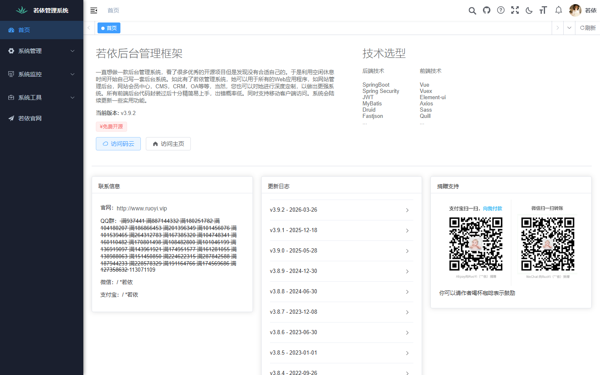
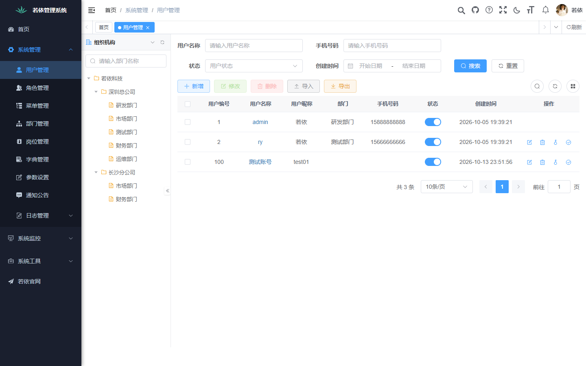

# ruoyi-test-automation


基于 RuoYi-Vue 后台管理系统的自动化测试项目，覆盖 UI 走查与接口测试，配套测试用例库（Excel）与可交付的 HTML 测试报告。

被测系统：[RuoYi-Vue](https://github.com/yangzongzhuan/RuoYi-Vue)（Spring Boot + Vue 后台权限管理系统）

## 技术栈

| 组件 | 版本 | 用途 |
|---|---|---|
| Python | 3.11 | 运行环境 |
| pytest | 9.2.0 | 测试框架，用例组织与断言 |
| Playwright | 1.65.2 | 浏览器自动化（channel 模式驱动本机真实 Chrome / Edge） |
| requests | 2.34.2 | 接口测试 HTTP 客户端 |
| openpyxl | 3.1.5 | 测试用例库读写 |
| pytest-html | 4.2.0 | 生成单文件 HTML 报告 |
| python-dotenv | 1.2.4 | 配置外置到 `.env` |

## 目录结构

```
ruoyi-test-automation/
├── .github/workflows/
│   ├── ci.yml                 静态检查：依赖安装 / 模块导入 / 用例收集（~13s）
│   └── integration.yml        集成回归：CI 从空白环境拉起被测系统跑接口用例（~2.5min）
├── config/                    配置中心，全部来自环境变量，启动时快速失败
│   └── settings.py
├── utils/                     工具层：用例只调接口，不关心实现
│   ├── api_client.py          接口客户端：Session 会话 / token 自动附加 / 两级业务码解析
│   ├── redis_helper.py        验证码 / 计数器读取
│   └── evidence.py            前端四类异常证据收集与统一判定
├── tests/
│   ├── api/
│   │   ├── conftest.py        client fixture + 账号锁定保护（yield teardown）
│   │   ├── test_login.py      登录正向 / 反向（异常断言 + 会话污染检查）
│   │   ├── test_user_crud.py  用户 CRUD 链式场景（时间戳命名幂等 + 零残留清理）
│   │   └── test_security.py   未授权 / 伪造 token / SQL 注入 / 目录穿越回归（xfail）
│   └── ui/
│       └── test_browser_walkthrough.py   双浏览器核心流程走查
├── data/                      测试用例库（Excel）
├── reports/                   测试报告（不提交）
├── screenshots/               运行期证据截图（不提交）
├── docs/                      README 引用的精选截图（提交）
├── requirements.txt
├── pytest.ini
├── .env.example
└── .gitignore
```

## 快速开始

```bash
python -m venv .venv
source .venv/Scripts/activate        # Windows Git Bash；PowerShell 用 .\.venv\Scripts\Activate.ps1
pip install -r requirements.txt
cp .env.example .env
```

编辑 `.env`，按本机实际情况填写：

```ini
BASE_URL=http://localhost
REDIS_CLI=E:/LearningSoftware/Memurai/memurai-cli.exe
EVIDENCE_DIR=screenshots
LOGIN_USER=admin
LOGIN_PASS=admin123
```

> 依赖已锁定在 `requirements.txt`，`pip install -r` 可复现完全一致的环境。
> 不需要执行 `playwright install`：本项目用 `channel` 模式驱动本机已安装的 Chrome / Edge，不下载浏览器内核。

## 运行

```bash
# 接口用例（8 条，约 2 秒）
pytest tests/api -v

# 全部 UI 用例 + 生成单文件 HTML 报告
pytest tests/ui -v --html=reports/report.html --self-contained-html

# 只跑某一个浏览器（失败重跑时常用）
pytest tests/ui -v -k chrome

# 只跑用例名包含 walkthrough 的
pytest -k walkthrough -v
```

## 测试设计要点

1. **验证码直读 Redis，不依赖 OCR**
   监听 `/captchaImage` 响应取回 `uuid`，再读取 Redis 的 `captcha_codes:{uuid}` 得到答案。相比截图识别，速度快、无识别失败率。
   注意：Redis 中该值带双引号（Jackson 序列化），需要 `strip('"')`。

2. **驱动真实浏览器，不下载内核**
   `p.chromium.launch(channel="chrome" / "msedge")` 直接复用本机已安装的 Chrome 与 Edge，省去 100MB+ 的内核下载，也让测试环境与用户实际使用环境一致。

3. **参数化双浏览器覆盖**
   同一个用例通过 `@pytest.mark.parametrize("channel", ["chrome", "msedge"])` 展开为两条独立用例，报告中分别呈现结果与耗时，失败时可单独重跑，不必陪跑。

4. **四类前端证据统一收集**
   走查全程收集 `console error`、`pageerror`、`requestfailed`、HTTP `4xx/5xx`，由 `Evidence.ok` 统一判定，断言失败时输出 `summary()`，直接定位到具体异常与 URL。

5. **配置即校验，错误早暴露**
   `config/settings.py` 在导入时校验必填变量，缺少 `REDIS_CLI` 或 `LOGIN_PASS` 立刻抛出中文错误，避免跑到登录步骤才因 401 返工。

6. **测试数据与代码分离**
   用例库为独立 Excel 文件，脚本只读取不内嵌数据。

## 断言分层

| 断言 | 验证目标 |
|---|---|
| `"/login" not in page.url` | 登录是否真正跳转成功（而非停留在登录页） |
| `.el-table__row` 数量 > 0 | 列表接口是否真实返回数据（而非白屏或报错遮罩） |
| `ev.ok` | 全程是否无前端异常（四类证据全空） |

## 稳定性加固

- **已修复：验证码竞态导致的偶发失败（flaky）**

  问题：首版使用固定 `wait_for_timeout` 等待页面渲染，在验证码请求与首屏渲染存在竞态时，Chrome 偶发出现登录未跳转（重跑即通过）。

  修复措施：

  1. 用 `page.expect_response(...)` 包裹点击动作，等待登录请求**真正发出**，取回响应码与响应体用于诊断
  2. 用谓词判断是否离开登录页：`wait_for_url(lambda url: "/login" not in url)`
  3. 列表页改为两级等待：`wait_for_url("**/system/user")` 等路由切换 + `wait_for_selector(".el-table__row")` 等数据渲染
  4. 登录失败重试一次（仅限验证码等环境抖动点，**业务断言不重试**，避免掩盖缺陷）

  期间踩到的一个坑：`wait_for_url("**/index")` 会被登录页自身的 `?redirect=/index` 误匹配，导致等待立即返回、登录请求尚未发出——**等待条件必须能区分"成功"与"失败"两种状态，能用谓词就不要用通配符**。

  效果：单次执行 **20.4s → 11.5s**，连续 3 次运行均 `2 passed`。

## 接口自动化设计要点

1. **两级业务码断言**：RuoYi 的 HTTP 层永远返回 200，成败由 body 的 `code` 承载（200/601/500），认证失败也只体现在业务码 401。封装层统一做「HTTP 状态码 + 业务码」双重校验；`expect_code` 参数让反向用例复用同一套断言逻辑。
2. **fixture 依赖注入 + yield 拆卸**：登录态由 `conftest.py` 的 fixture 统一提供；错误密码计数、CRUD 测试用户均通过 teardown 清理，任意用例失败也保证零残留（反向用例会清除错误密码计数器，防止把 admin 锁死）。
3. **链式场景覆盖 CRUD**：新增 → 查询确认 → 修改 → 删除 → 回查组成一条数据生命周期，用户名带时间戳天然唯一，可重复运行（幂等）；断言坚持「数据回查」，不信任接口返回值本身。
4. **安全用例验证"正确地拒绝"**：未授权与伪造 token 断言业务码 401；SQL 注入断言注入串被当作字面量（`total=0` 证明参数化查询生效）；封装层保留 `raw()` 逃生舱口，安全用例拿原始响应自行判定。
5. **已知缺陷的回归监控**：目录穿越缺陷（拦截生效但异常被静默吞掉返回空 200）写成期望正确行为的用例并标记 `xfail`——缺陷修复当天它自动转为通过，用测试套件追踪缺陷生命周期。

## 持续集成

| 工作流 | 内容 | 耗时 |
|---|---|---|
| **CI** | 全新环境验证：依赖安装、模块导入、用例收集——保证仓库随时可复现 | ~13s |
| **Integration** | 从空白环境**拉起完整被测系统**再回归：MySQL/Redis 服务容器 → 导入官方 SQL → 克隆 RuoYi-Vue 源码 → Maven 打包 → 启动后端 → 运行 8 条接口用例 | ~2.5min |

集成工作流踩过并修复的环境差异（记录于此，供排错参考）：

- `setup-java` 的 `cache: maven` 要求仓库内存在 pom.xml——被测系统是运行时克隆的，不能用该缓存
- RuoYi 官方 `logback.xml` 硬编码日志路径 `/home/ruoyi/logs`，CI 的 Linux 用户无权创建——sed 改写到 `/tmp`
- 数据源/密码不信任上游默认值，构建前用 sed 强制对齐本环境

## 测试报告与证据

报告由 pytest-html 生成，`--self-contained-html` 保证单文件可独立分发。





## 后续计划

- 继续扩充接口用例（当前 8 条：登录 2 / 用户 CRUD 链 1 / 安全 5），覆盖角色、字典等模块
- 集成测试接入 pytest-xdist 并行执行，缩短云端回归时间
- UI 用例纳入 CI（云端安装 Chrome 内核跑冒烟走查）
